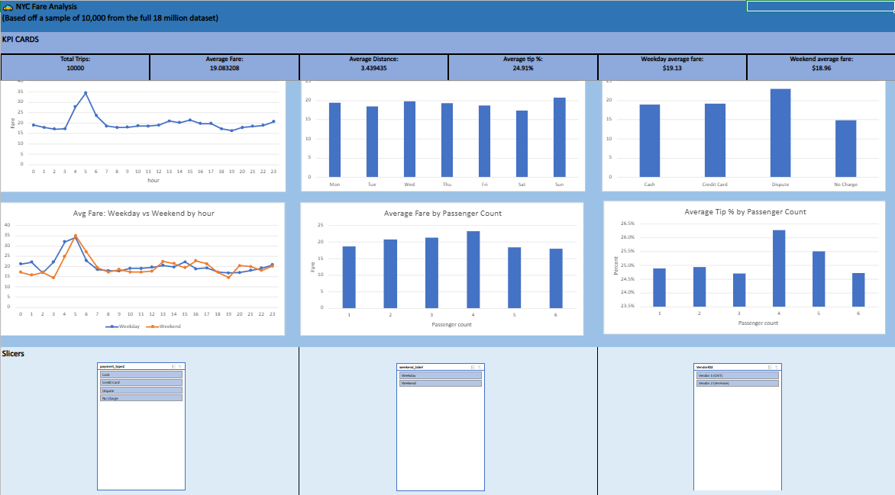

# NYC Taxi Fare Analysis

A start-to-end project analyzing 19.5M NYC yellow taxi trips using SQL, Python, and Excel.

## Project Overview
This project processes 19.5 million raw NYC TLC trip records (Jan to Aug 2023). It uses SQLite for heavy-duty cleaning, Python (Pandas, Scikit-learn) for exploratory data analysis and regression modeling, and Excel for an interactive business dashboard.

## Key Findings

- **The 5 AM Spike is an Airport Mix Effect:** Average fares spike at 5 AM (~$27). While non-airport trips at 5 AM are actually cheaper than average ($13.23), the share of airport-related trips jumps from ~11% at noon to ~31% at 5 AM.
- **Distance is the Primary Driver:** A linear regression model predicting fare based on distance, time, and airport flags achieved an R² of 0.916 and an MAE of $1.95 (beating the distance-only baseline of R² 0.897 / MAE $2.80).
- **The "Weekend" Myth:** Weekday vs. weekend fares are statistically insignificant (p=0.43). However, this hides opposing extremes: Saturday is the cheapest day ($17.31) and Sunday is the most expensive ($20.77).
- **Vendor Data Discrepancy:** Discovered a data-quality trap where Vendor 1 excludes the congestion surcharge from the `total_amount` column, while Vendor 2 includes it. 

## Dashboard Preview

The Excel dashboard uses a 10,000-row sample because of browser limits, while the Python model uses a 200,000-row sample.

## Tech Stack & Pipeline

1. **SQL (SQLite):** Loaded 2.2 GB CSV, cast data types, handled NULLs, removed 1.3M invalid rows, and exported a clean dataset of 18.2M rows.
2. **Python (Pandas, Scikit-learn):** Feature engineering, outlier capping, statistical t-tests, and linear regression.
3. **Excel:** PivotTables, slicers, and KPI cards for interactive dashboard for stakeholders.

## Repository Structure

- `report/` - The complete PDF report
- `sql/` - The SQL cleaning script
- `python/` - The Python analysis script
- `excel/` - The interactive Excel dashboard
- `data/` - A 10,000-row sample of the cleaned data

## How to Reproduce
1. Download the raw dataset from [Kaggle](https://www.kaggle.com/datasets/nagasai524/nyc-taxi-trip-records-from-jan-2023-to-jun-2023).
2. Run `sql/clean_taxi_trips.sql` in SQLite to generate `taxi_trips_final.csv`.
3. Run `python/taxi_analysis.py` to generate the EDA charts and the 10k-row Excel sample.
4. Open `excel/NYC_Taxi_Dashboard.xlsx` to explore the interactive dashboard.
